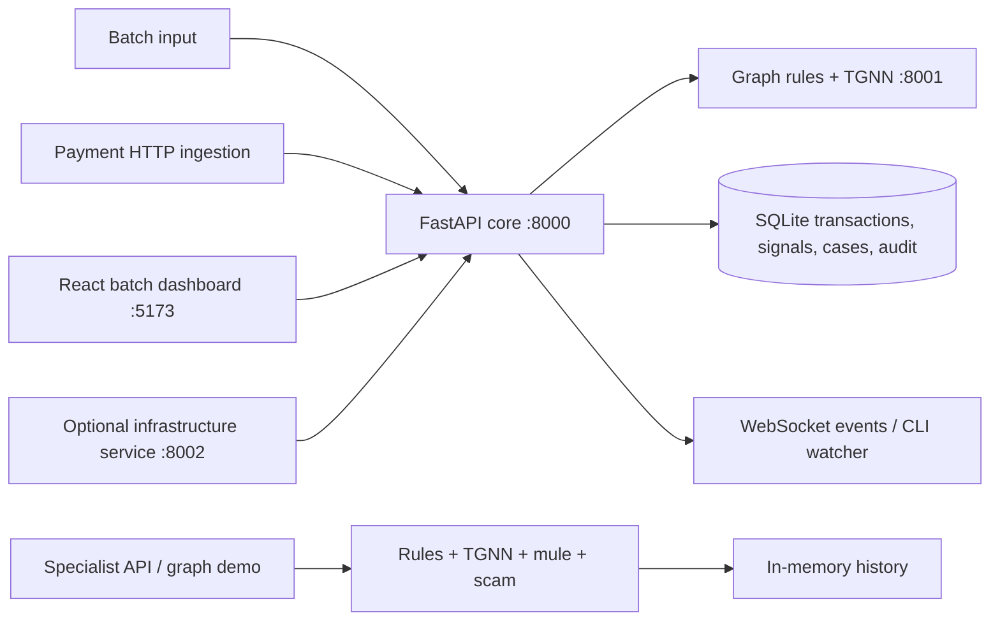

# ARGUS — Financial Fraud Intelligence

[](https://github.com/pratyushdeosingh/ARGUS_CSI/actions/workflows/ci.yml)

ARGUS is a fintech prototype for analysing payment transactions, detecting
suspicious account behaviour and mule-like fund movement, and presenting risk
scores with evidence. It provides batch analysis, transaction ingestion,
WebSocket events, and a separate experimental transaction scoring engine.

**Status: partially implemented for Problem Statement #9.** The existing paths
are tested; the complete fintech workflow is still under development. The
coverage below follows the requirements supplied by the team. It is not a claim
of complete compliance with an independently verified competition rubric.

- [Prioritized work checklist](TODO.md)
- [Verification results and limits](docs/verification.md)
- [API contracts and integration boundaries](docs/integration.md)
- [Demo walkthrough](docs/demo-script.md)

## Coverage of the fintech requirements

| Requirement | Current implementation | Gap |
| --- | --- | --- |
| Suspicious transaction detection | Rules for amount, velocity, identity changes, new beneficiaries and money flow | Independent accuracy evaluation |
| Fraudulent customer behaviour | Comparison with supplied historical transactions | No customer/KYC ingestion or validated customer classifier |
| Graph analytics | Directed account graph, temporal paths, forwarding and fan-in/fan-out | Explicit cycle detection, communities and centrality-based investigation |
| Mule detection | Temporal money-flow rules; specialist fan-in, forwarding and turnover heuristics | Specialist results are separate from core scoring and React |
| Scam detection | Specialist fan-out, burst, repeated-amount and volume-surge heuristics | Broader labelled scam evaluation and core/UI integration |
| AI/ML | PyTorch temporal graph neural network with a bundled checkpoint | Trained on synthetic demo batches; no independent held-out evaluation |
| Explainability | Rule evidence, account/transaction references and specialist detector breakdown | No SHAP or validated ML attribution; node scores are not feature attribution |
| Real-time payments | Per-payment HTTP ingestion, rolling graph analysis and WebSocket events | No durable alert queue/retry pipeline; React does not subscribe yet |
| Investigation cases | SQLite cases, analyst approval and simulated actions for cross-domain analysis | Financial-only scores/stream alerts do not yet create durable cases |
| RegTech | Case history and simulated response audit trail | Compliance workflow and draft suspicious activity reporting |
| Evaluation and datasets | Synthetic normal/attack fixtures and scenario tests | Representative dataset, held-out splits, precision, recall, F1, PR-AUC and false-positive analysis |

## Working application paths

### Batch financial analysis

`POST /api/analyze` accepts 1–5,000 transactions and optional baseline history.
The backend calls the graph service and stores transactions and its signal.
Without infrastructure evidence, the response has `system_signal: null` and
`incident: null`. Supplying telemetry or a system signal enables the existing
cross-domain incident workflow.

The graph service evaluates seven rules and the TGNN. Batch model risk can raise
the rule score only when independent rule risk is at least `0.40`. This guard
limits unsupported promotions by the demo-trained model; it is not model
calibration. Graph signal risk ranges from **0 to 1** and is not a calibrated
fraud probability. Signal identity includes transaction contents and the baseline.

### Continuous ingestion and alerts

`POST /api/transactions` persists one payment and scores a recent transaction
window. Identical delivery returns `200`; a new payment returns `201`; a reused
ID with different data returns `409`. Invalid input returns `422`.

Use an explicit `session_id` query parameter or `X-Session-ID` header to group a
stream. Without one, the transaction ID prefix is used as a demo grouping rule;
unrelated prefixes will not share a scoring window. Analysis runs within the
request, rather than through a separate streaming worker.

`/ws/transactions` emits `connection.established`, `transaction.received`,
`transaction.scored`, `alert.created`, and `transaction.analysis_failed` events.
A scoring failure does not undo ingestion. Alerts are transient WebSocket events;
there is no durable replay of missed alerts or automatic rescore on duplicate
payment delivery. Watcher and replay scripts are provided below.

### Supplementary scam stream

Ingestion also emits `transaction.scam_scored`, `scam_alert.created`, or
`transaction.scam_scoring_failed`. Raw specialist scores use 0–100 and explicitly
named normalized fields use 0–1. `SCAM_ALERT_THRESHOLD` defaults to 70/100.
Specialist scoring receives only the selected stream session's bounded history;
it does not accumulate unrelated callers in the shared demo engine. Fixture
mode reports scoring unavailable rather than inventing a clean/ALLOW result.
The standalone `/score-transaction` demo retains its separate in-memory history.

These supplementary events are not persisted fraud cases or regulatory decisions.
Scam heuristics can still flag legitimate payroll, settlements, refunds or sparse
history; the new validation suite explicitly characterizes those limitations.
Real-data accuracy and live React integration remain pending.

### Specialist scoring

The graph service exposes `POST /score-transaction` and a standalone `/demo`.
It combines rules, TGNN, mule and scam heuristics into a **0–100** score with
`ALLOW`, `REVIEW` or `BLOCK` recommendations. These recommendations do not execute
payment controls. This experimental fusion is separate from the core batch/
stream score, and its history is in memory. Use a single graph-service worker.

### Analyst dashboard and optional infrastructure evidence

The React dashboard provides batch Data Lab analysis, account graphs, evidence,
detector provenance, case history and simulated containment approval. Its
canonical demo correlates financial risk with process/file/network telemetry.
The infrastructure detector runs in replay mode under Docker; guarded live
collection requires Linux and bpftrace.

The React dashboard currently has no WebSocket subscription or specialist score
breakdown. Use the watcher for streaming and the graph demo for specialist scores.
Containment is simulated. Replaying the same contained case preserves its stored
approval state and audit trail.

## Architecture



The specialist engine and live WebSocket stream are not yet connected to the
React analyst workflow. See [architecture details](docs/architecture.md).

## Run with Docker

Requires Git and Docker Engine/Desktop with Compose v2 running.

```bash
git clone https://github.com/pratyushdeosingh/ARGUS_CSI.git
cd ARGUS_CSI
docker compose up --build -d --wait --wait-timeout 120
```

| Interface | URL |
| --- | --- |
| React dashboard / Data Lab | [localhost:5173](http://127.0.0.1:5173) |
| Core API docs | [localhost:8000/docs](http://127.0.0.1:8000/docs) |
| Graph API docs | [localhost:8001/docs](http://127.0.0.1:8001/docs) |
| Specialist scoring demo | [localhost:8001/demo](http://127.0.0.1:8001/demo) |
| Optional infrastructure API docs | [localhost:8002/docs](http://127.0.0.1:8002/docs) |

Compose starts all four services, including infrastructure replay. Financial
analysis itself can run without supplying infrastructure evidence. Database
history is stored in the `argus-runtime` named volume. Stop with
`docker compose down`; `down -v` deletes that volume and its history.

## Run without Docker

Use Python 3.11 or 3.12, Node.js 22 and pnpm 11.22.0. From the repository root:

```powershell
py -3.11 -m venv .venv
.\.venv\Scripts\Activate.ps1
python -m pip install torch --index-url https://download.pytorch.org/whl/cpu
python -m pip install -r backend/requirements.txt -r services/graph-detector/requirements.txt -r services/ebpf-detector/requirements.txt
npm install --global pnpm@11.22.0
pnpm --dir frontend install --frozen-lockfile
```

Start each process in a separate terminal with the virtual environment activated:

```powershell
# Graph service
python -m uvicorn app:app --app-dir services/graph-detector --host 127.0.0.1 --port 8001
```

```powershell
# Infrastructure replay (needed for the cross-domain demo)
$env:ARGUS_EBPF_MODE = "replay"
python -m uvicorn api:app --app-dir services/ebpf-detector --host 127.0.0.1 --port 8002
```

```powershell
# Core backend
$env:ARGUS_DETECTOR_MODE = "required"
python -m uvicorn backend.app.main:app --host 127.0.0.1 --port 8000
```

```powershell
# Dashboard
pnpm --dir frontend dev --host 127.0.0.1
```

On macOS/Linux, use `python3`, `source .venv/bin/activate`, and `export NAME=value`.
The checkpoint in `services/graph-detector/tgnn_weights.pt` is required for graph
startup. Startup does not train a model or silently substitute random weights.

## Demonstrate streaming

With the core and graph services running, open a watcher terminal:

```powershell
python scripts/watch_transactions.py --url ws://127.0.0.1:8000/ws/transactions
```

Replay synthetic data in another terminal. Use a new run ID for each run:

```powershell
python scripts/replay_transactions.py --input data/generated/normal.json --run-id normal-demo-01 --interval 0.2
python scripts/replay_transactions.py --input data/generated/mule.json --run-id mule-demo-01 --interval 0.2
```

See [script options](scripts/README.md) for generating new datasets. Synthetic
scenario success does not establish real-world fraud detection accuracy.

## Configuration

[.env.example](.env.example) lists supported settings. Compose reads the root
`.env` for its explicitly mapped variables. For manual Python startup, export
variables in the shell; the backend does not automatically load a `.env` file.

| Setting | Default | Purpose |
| --- | --- | --- |
| `ARGUS_DETECTOR_MODE` | `auto` locally, `required` in Compose | Demo fallback policy; arbitrary batch/stream analysis still requires the graph service |
| `GRAPH_DETECTOR_URL` / `EBPF_DETECTOR_URL` | localhost ports 8001 / 8002 | Core detector connections |
| `DETECTOR_TIMEOUT_SECONDS` | `2.5` locally, `5` in Compose | Detector request timeout |
| `ARGUS_DB_PATH` | `data/argus.db` locally | SQLite path; Compose uses its mounted runtime volume |
| `FRAUD_ALERT_THRESHOLD` | `0.70` | Stream alert threshold on the 0–1 graph score |
| `ANALYSIS_WINDOW_MINUTES` | `15` | Stream event-time window |
| `ANALYSIS_MAX_TRANSACTIONS` | `100` | Maximum recent payments scored per stream window |
| `ARGUS_GRAPH_BASELINE` | bundled normal transactions | Graph startup baseline path, set on the graph process |
| `ARGUS_EBPF_MODE` | `auto` locally, `replay` in Compose | Infrastructure collection mode |
| `VITE_API_BASE_URL` | `http://127.0.0.1:8000` | Frontend build/dev API URL |

`auto` and `fixture` support the canonical demonstration and visibly label
fallbacks. They do not provide substitute scoring for arbitrary caller data.

## Verify

```powershell
python -m pytest -q
pnpm --dir frontend test
pnpm --dir frontend build
```

With the full stack running and Python dependencies installed:

```powershell
python -m backend.app.integration_check
python scripts/check_integrated_stack.py
```

The smoke test writes synthetic transactions/cases to the running stack. Use a
demo database. CI runs unit tests, frontend tests/build, container builds, health
checks and service smoke tests on pull requests and pushes to `main`. See the
[verification report](docs/verification.md) for the checked revision, scope and
known gaps. Passing tests do not mean every fintech requirement is implemented.

## Team and repository

| Contributor | Next responsibilities |
| --- | --- |
| Pratyush | Model evaluation, core risk integration, financial-only cases, RegTech |
| Pratham | Graph analytics, mule networks, specialist evidence and graph validation |
| Yojit | Live React dashboard, stream reliability, scam integration and demo flow |

Nitin contributed the existing infrastructure detector. Current fintech work is
assigned to Pratyush, Pratham and Yojit.

```text
backend/                       Core API, persistence, correlation and approval
services/graph-detector/       Graph rules, TGNN, specialist engine and demo
services/ebpf-detector/        Infrastructure replay and guarded Linux collection
frontend/                      React batch analysis and investigation dashboard
contracts/                     Shared transaction and signal JSON schemas
scripts/                       Synthetic generator, replay, watcher and smoke check
data/                          Synthetic fixtures and local runtime database
docs/                          Integration, verification, architecture and demo
TODO.md                        Prioritized next work with acceptance criteria
```

This is a synthetic-data prototype. It has no production payment integration,
operator authentication or role-based access control. Actions are simulated;
there are no bank freezes or real transfer cancellations. Regulatory compliance,
model accuracy, throughput and production readiness have not been established.
